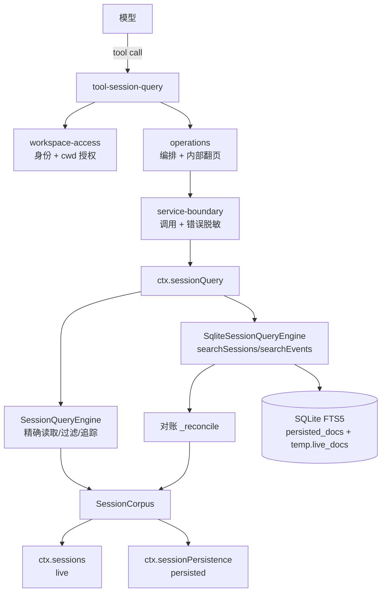

# DSH Session Query 设计与实现

> 对象：DeepSeek Harness（`dsh`）的会话历史检索能力族
> 代码位置：`packages/session-query/`
> 适用版本：仓库当前 checkout（`@deepseek-ai/dsh-tool-session-query@0.1.3-alpha.1`）

---

## 1. 定位与能力边界

Session Query 解决的问题是：**在不破坏会话日志、不把会话变成 live 状态的前提下，对历史会话做精确读取、关系追踪和全文检索，并把其中一部分能力以模型工具的形式暴露出来。**

它有三层，且严格分离：

| 层 | 包 | 职责 |
|---|---|---|
| 模型工具层 | `@deepseek-ai/dsh-tool-session-query` | 5 个只读工具、参数校验、工作区授权、错误脱敏、文本呈现 |
| 服务层 | `@deepseek-ai/dsh-session-query` | 与后端无关的会话读取、过滤、血缘/事件追踪、语义文档抽取 |
| 索引后端层 | `@deepseek-ai/dsh-session-query-sqlite` | SQLite FTS5 派生索引、增量对账、排序、分页、snippet |

另有 `@deepseek-ai/dsh-session-log-export` 提供 Web `/export` 下载会话 ZIP，与检索共用底层读取思路，但不是模型工具。

关键定位：

- **只读**：不写入 canonical 会话日志。
- **live 优先**：同一 session id 同时存在于内存和持久化时，永远以内存中的 live 会话为准。
- **workspace 授权**：跨会话访问要求 `cwd` 完全字符串相等。
- **opt-in**：官方默认宿主组合不挂载工具包，也不默认打开搜索索引。
- **模型侧无 cursor**：分页在工具内部完成，模型只看到结果或“达到上限”。

---

## 2. 包结构与依赖

```text
packages/session-query/
├─ session-query/                 # 服务契约 + 后端无关实现
│  ├─ src/index.ts                # abstract SessionQueryEngine
│  ├─ src/types.ts                # 全部公共类型
│  ├─ src/config.ts               # 配置默认值与错误码
│  ├─ src/corpus.ts               # live/persisted 语料解析
│  ├─ src/cold-read.ts            # 冷日志一次性读取 + 中断回合补齐
│  ├─ src/observation.ts          # 精确快照 + 冷观察 LRU 缓存
│  ├─ src/documents.ts            # 事件 -> 语义文档 + surface 分类
│  ├─ src/extraction.ts           # 每种事件的可检索文本
│  ├─ src/filters.ts              # 与后端无关的过滤谓词
│  ├─ src/tracing.ts              # 血缘与事件关系追踪
│  ├─ src/cursor.ts               # 不透明 cursor 品牌类型
│  └─ src/sources.ts              # header 一致性校验
├─ session-query-sqlite/          # FTS5 后端
│  ├─ src/schema.ts               # 表结构、版本、打开与保护
│  ├─ src/query.ts                # 请求规范化、SQL 谓词、snippet
│  └─ src/index.ts                # 对账、索引写入、搜索执行、cursor
├─ tool-session-query/            # 模型工具
│  ├─ src/index.ts                # 插件注册 + 配置 + system prompt
│  ├─ src/input.ts                # JSON Schema + 参数规范化
│  ├─ src/operations.ts           # 5 个操作编排
│  ├─ src/workspace-access.ts     # 调用者身份、授权、标题读取
│  ├─ src/service-boundary.ts     # 服务调用与错误脱敏
│  └─ src/presentation.ts         # 纯文本输出与调用卡片
└─ session-log-export/            # Web /export 命令（旁路）
```

依赖方向：

```text
tool-session-query  ──►  session-query  ◄──  session-query-sqlite
        │                     │
        └──► @deepseek-ai/dsh-tools / dsh-agent / dsh-session-projection
                              │
                              └──► @deepseek-ai/dsh-session
                                   @deepseek-ai/dsh-session-persistence
                                   @deepseek-ai/dsh-session-title
```

`SessionQueryEngine` 只 `inject = ['sessions']`；持久化和投影都是**可选服务**，用 `ctx.inject` / `ctx.get` 动态绑定，因此没有持久化后端时精确读取仍能工作，只是搜不到冷会话。

---

## 3. 总体架构



一次搜索的端到端链路：

1. 工具层从 `exec.agent` 取调用者 session，构造 `cwd` 过滤。
2. 工具层规范化 query/filters，调用 `ctx.sessionQuery.searchSessions/searchEvents`。
3. SQLite 后端串行化请求，打开索引，执行对账（把 live 与 persisted 的最新状态同步进派生索引）。
4. 执行 FTS5 查询、过滤、排序、`limit + 1` 预读分页。
5. 工具层在内部循环翻页，跳过未授权项，直到收集到 `maxSearchResults` 或没有下一页。
6. 工具层读取标题、裁剪越权血缘、渲染纯文本。

---

## 4. 核心数据模型

### 4.1 会话记录

```ts
interface SessionRecord {
  header: SessionHeader      // version/id/createdAt/cwd/parentSession/isSeeded/delegationDepth/agentPreset
  live: boolean              // 当前存在于 ctx.sessions
  persisted: boolean         // 当前持久化后端列出
}
```

`listSessions()` 的顺序是 `createdAt` 降序，再按 id 升序，保证确定性。

### 4.2 事件记录与语义文档

```ts
interface SessionEventRecord {
  sessionId: SessionId
  seq: SessionSeq
  type: SessionEventType
  time: number               // Unix epoch ms
  surface: 'current' | 'shadowed' | 'log-only'
}

interface SessionEventSearchDocument extends SessionEventRecord {
  text: string               // 抽取后的语义文本
}
```

- `current`：surface fold 后的当前节点。
- `shadowed`：被后续替换事件遮蔽。
- `log-only`：不在模型 surface 中，但仍是日志事件。

### 4.3 搜索命中

```ts
interface SessionEventSearchHit extends SessionEventRecord {
  snippet: string
}

interface SessionSearchHit extends SessionRecord {
  bestMatch: SessionEventSearchHit   // 该会话最强命中
}

interface SessionSearchPage<T> {
  items: T[]
  nextCursor?: SessionSearchCursor
}
```

`searchEvents` 额外返回 `session: SessionHeader`，它与 `items` 来自同一个索引 generation，避免分页过程中目标会话被替换导致结果错位。

### 4.4 不透明 cursor

```ts
type SessionSearchCursor = Branded<'SessionSearchCursor'>
```

真实 payload 只在 SQLite 后端内部：

```ts
interface CursorPayload {
  version: 1
  instance: string       // 进程内唯一，防跨实例重放
  scope: 'sessions' | 'events'
  fingerprint: string    // 规范化请求指纹
  generation: string     // 相关语料 generation
  offset: number
}
```

模型永远看不到它；工具层用 `collectPages` 内部消费。

---

## 5. 事件文本抽取

`extractSessionEventText`（`extraction.ts`）决定“什么内容可被搜到”。这是检索质量的核心。

| 事件类型 | 抽取内容 |
|---|---|
| `user/message` | `content` 中 `text` 块、`tool-call` 的 name/arguments、`tool-result` 的递归内容 |
| `assistant/message` | 同上 |
| `tool/call` | 工具名 + 参数 |
| `tool/result` | 结果内容 + 错误 name/code |
| `todo/write` | 每条 todo 的 status + content |
| `turn/end` | 错误消息 / aborted / max-tokens / interrupted |
| `turn/start`、`step/start`、`step/end`、`assistant/attempt`、`request/header` | 空（结构性事件） |
| 未知事件类型 | 空 |

明确排除：

- `reasoning` 块不进入索引。
- 未知 `ContentBlock` 不因为“里面恰好有字符串”就可搜。
- 结构性边界和 request envelope 不进入索引。

空文本事件不会生成文档，因此不会出现在搜索结果中。

---

## 6. 语料解析：live 优先

`SessionCorpus`（`corpus.ts`）是“逻辑会话语料”的唯一入口。

### 6.1 listSessions

1. 列出持久化后端所有 header，构造 `{live:false, persisted:true}`。
2. 遍历 `ctx.sessions.list()`；同 id 覆盖为 live，并做 header 兼容性校验。
3. 按 `createdAt desc, id asc` 排序。

### 6.2 load（精确读取）

```text
ctx.sessions.get(id) 命中?
  ├─ 是 → snapshotLive：结构化克隆 header + 事件，立即返回
  └─ 否 → 无持久化? → notFound
          有持久化 → list 找到 header → readColdSessionLog
                    → 读取期间会话被 attach? → 改用 live 快照
                    → 校验 header 兼容 → 返回冷快照
```

“已知 live 目标绝不查持久化”是有意设计：可选后端的故障不能导致当前内存历史不可读。

### 6.3 cold read

`readColdSessionLog`：

1. `persistence.open(sessionId, 'read')`
2. `handle.read(0, undefined)`
3. `handle.close()`
4. 追加 `interruptedTurnClosers(events)`

最后一步让“写入者中途崩溃”的日志在内存中表现为平衡 transcript，**不回写存储**。

### 6.4 projectMany

批量读取标题等场景使用：先解析所有 live，再对 persisted 使用 `persistedReadConcurrency`（默认 4）并发读取；单个失败被隔离为 `rejected`，取消则整体抛出。

---

## 7. 精确观察与冷缓存

`SessionObservationReader`（`observation.ts`）提供“一次精确、不可变的快照 + 租约”。

- live 路径：直接取 `session.snapshotEvents()`。
- 冷路径：
  1. `persistence.stat` 取 revision。
  2. 若缓存命中同 persistence 实例 + 同 revision，复用。
  3. 否则冷读日志，`ctx.sessions.prepare(...)` 构造一个**未发布**的 Session（不会进入 store）。
  4. 缓存条目按 LRU 淘汰，`preparedSessionCacheSize` 默认 5。
  5. 被租约 pin 住的条目不会被淘汰；`retain()` 增加引用，`Symbol.dispose` 减少引用。

这让“读取冷会话”不需要把它变成 live，也不需要每次重读日志。

---

## 8. 过滤系统

`filters.ts` 是纯函数层，服务层和后端层共用。

语义：

- 过滤数组之间 **AND**。
- 同一子句的 `values` 内部 **OR**。
- 范围闭区间。

会话过滤：

| kind | 含义 |
|---|---|
| `id` | session id 列表 |
| `cwd` | 工作目录，含 `null` |
| `created-at` | 创建时间范围 |
| `parent` | 直接父会话，含 `null` |
| `availability` | `live` / `persisted` 至少一个 |

事件过滤：

| kind | 含义 |
|---|---|
| `seq` | 事件序号范围 |
| `time` | 事件时间范围 |
| `type` | 事件类型 |
| `surface` | `current` / `shadowed` / `log-only` |
| `text` | **字面**、大小写不敏感、空白灵活的正则扫描 |

`text` 过滤器的实现：

```ts
const pattern = trimmed
  .split(/\s+/u)
  .map(part => part.replace(/[.*+?^${}()|[\]\\]/gu, '\\$&'))
  .join('\\s+')
return new RegExp(pattern, 'iu')
```

即：转义正则元字符、把空白替换成 `\s+`、用 `iu` 标志。它是**子串级**匹配，和 FTS 的 token 匹配不同。

注意：`SessionEventMetadataFilter` 显式排除了 `text`，所以 FTS 后端不接受 `text` 过滤；`text` 只用于服务层 `filterEvents` 的扫描路径。模型工具也没有暴露它。

---

## 9. 关系追踪

`tracing.ts` 基于一次 canonical `foldSurface(events)`：

### 9.1 事件追踪 `traceEvent`

返回：

```ts
{
  target: SessionEventRecord
  replacedBy?: SessionSeq
  replacementChain: SessionSeq[]       // 沿 replacedBy 一直向上
  replacedEventSeqs: SessionSeq[]      // 被 target 直接替换的事件
  sourceEventSeqs: SessionSeq[]        // target 直接引用的源事件
  derivedEventSeqs: SessionSeq[]       // 后续直接引用 target 的事件
}
```

### 9.2 会话血缘 `traceSession`

1. 从 target 沿 `parentSession` 向上收集祖先，检测环。
2. 从全量 records 构建 `childrenByParent`，按 `createdAt, id` 排序。
3. 迭代式构建后代树（避免递归深度问题）。
4. 如果父链走出可见语料，返回 `complete:false` 和 `unresolvedParentId`；否则返回 `root`。

工具层再把越权的祖先/后代替换成 `[outside workspace boundary]` / `[outside workspace subtree]`，不泄露隐藏 id。

---

## 10. SQLite FTS5 后端

### 10.1 数据库结构

`SESSION_QUERY_SQLITE_SCHEMA_VERSION = 8`
`SESSION_QUERY_SQLITE_APPLICATION_ID = 0x44534851`

持久表：

```sql
search_state(singleton, global_generation)

persisted_sessions(
  id, version, created_at, cwd, parent_session,
  seed_length, delegation_depth, agent_preset,
  revision, generation
)

persisted_docs USING fts5(
  text,
  session_id UNINDEXED,
  seq UNINDEXED,
  type UNINDEXED,
  time UNINDEXED,
  surface UNINDEXED,
  codepoint_length UNINDEXED,
  tokenize = 'unicode61'
)
```

连接级临时表：

```sql
temp.live_sessions(... fingerprint, persisted, generation ...)
temp.live_docs USING fts5(...)
```

设计要点：

- 这是**派生索引**，不是 canonical 存储；路径必须独立，不能指向 session persistence 数据库。
- 打开时校验 `application_id` 和用户表集合，拒绝外来数据库。
- 版本不匹配时原地重置派生表。
- 新建文件在 POSIX 上使用 `0600`，目录 `0700`。
- live 索引放 TEMP 表：进程结束即消失，不需要持久化未 checkpoint 的 live 事件。

### 10.2 索引打开策略

`openAt`：

- `startup`：服务激活时打开。
- `first-search`：第一次搜索时懒加载 `node:sqlite`。
- `never`：完全不导入 SQLite；`searchSessions/searchEvents` 抛 `SESSION_QUERY_SEARCH_DISABLED`，但精确读取/过滤/追踪仍可用。

### 10.3 对账（reconciliation）

每次搜索前都会 `_reconcile`，把索引同步到最新语料。核心步骤：

1. `_serialized`：所有搜索操作通过 `_tail` 串行队列，避免 FTS5 游标和事务并发问题。
2. 读取当前 `persisted_sessions` 与 `temp.live_sessions` 索引行。
3. `_observeStable` 最多尝试 2 次：
   - `persistence.list()` 前快照。
   - 对 revision 变化且未被 live 遮蔽的会话做冷读并生成文档。
   - `persistence.list()` 后快照；前后必须一致。
   - 检查 persistence 服务绑定是否在过程中变化。
   - 检查 live session 集合是否变化。
4. 计算差异：
   - persisted 新增/变化/删除
   - live 新增/变化（fingerprint 或 persisted 标志变化）/删除
5. 单事务 `BEGIN IMMEDIATE` 写入：
   - 删除旧 persisted/live 行
   - 插入新 header 与文档
   - 更新 `global_generation`
   - `COMMIT`
6. generation 规则：
   - persisted 变化 → main generation + 1
   - 每次 live 替换 → local generation = max(local, main) + 1
   - 指针变化或写入 → `_globalGeneration += 1`

live 的 fingerprint：

```ts
sha256(JSON.stringify({ header, inheritedEventCount, events }))
```

因此 live 会话只要事件有任何变化，就会重写自己的索引行。

### 10.4 搜索 SQL

`selectedDocumentsSql()` 用 `UNION ALL` 合并两个来源：

```sql
-- persisted
FROM persisted_docs pd
JOIN persisted_sessions ps ON ps.id = pd.session_id
WHERE persisted_docs MATCH ?
  AND ? = 1
  AND NOT EXISTS (SELECT 1 FROM temp.live_sessions ls WHERE ls.id = pd.session_id)

UNION ALL

-- live
FROM temp.live_docs ld
JOIN temp.live_sessions ls ON ls.id = ld.session_id
WHERE live_docs MATCH ?
```

`NOT EXISTS` 实现 **live 遮蔽 persisted**，所以同一会话不会出现两份结果。

`match_count` 不是 FTS 的 `bm25()`，而是通过 `highlight()` 插入的标记计数：

```sql
(length(marked_text) - length(replace(marked_text, marker, ''))) / marker_bytes
```

### 10.5 排序

事件搜索：

```sql
ORDER BY match_count DESC, document_length ASC, time DESC, seq DESC
```

会话搜索：

```sql
ROW_NUMBER() OVER (
  PARTITION BY session_id
  ORDER BY match_count DESC, document_length ASC, time DESC, seq DESC
) AS event_rank

... WHERE event_rank = 1
ORDER BY match_count DESC, document_length ASC, time DESC, session_id ASC, seq DESC
```

即：命中次数多、文档短、时间新的事件优先；跨会话再取每个会话的第一名。

### 10.6 分页与 cursor

- 查询 `limit + 1` 行，用多出的一行判断 `hasMore`。
- `nextCursor` 是 base64url(JSON)，绑定：
  - 实例 UUID
  - scope（sessions/events）
  - 规范化请求指纹
  - generation
  - offset
- cursor 失效分类：
  - 不属于该请求/实例/scope → `SESSION_QUERY_INVALID_CURSOR`
  - generation 变化 → `SESSION_QUERY_STALE_CURSOR`

### 10.7 snippet

`makeSnippet`：

1. 去掉 `highlight()` 插入的 `\uFDD0` / `\uFDD1` 标记。
2. 空白折叠为单个空格，去掉首尾空格。
3. 文本不超过 `snippetChars` 直接返回。
4. 否则围绕第一个命中位置开窗：起点约为 `matchStart - maxChars/3`，两端加 `…`。
5. 按 Unicode code point 截取，不会切断代理对。

---

## 11. 模型工具层

### 11.1 插件注册

`tool-session-query/src/index.ts`：

```ts
export const inject = ['tools', 'systemPrompt', 'sessionQuery', 'sessionProjections']
```

注册 5 个工具，并向 system prompt 注入固定一段引导文本。搜索工具带 `timeoutMs = searchTimeoutMs`（默认 30s）；追踪/读取工具标记 `isConcurrencySafe: () => true`，搜索工具没有标记，因为一次搜索会消费 generation 绑定的 provider cursor。

配置：

| 字段 | 默认 | 含义 |
|---|---:|---|
| `maxSearchResults` | 100 | 单次调用最多返回的授权命中数 |
| `searchTimeoutMs` | 30000 | 搜索协作式截止时间 |

### 11.2 参数与规范化

`input.ts` 定义 5 个工具的 JSON Schema：

- `session_search`：query + 会话/事件过滤
- `session_event_search`：session_id 可选 + query + 事件过滤
- `session_trace`：session_id 可选
- `session_event_trace`：session_id 可选 + seq
- `session_event_read`：session_id 可选 + seq + before/after

规范化规则：

- query：trim、空白折叠、拒绝空串、拒绝 NUL。
- seq/time 范围：非负安全整数；from ≤ to。
- 时间戳：必须是带时区的 ISO 8601，转成 epoch ms。
- `event_types` / `availability` / `surfaces` 必须非空。
- 父会话 id 去重。

### 11.3 授权模型

`workspace-access.ts`：

```text
caller = exec.agent.session
target = args.session_id ?? caller.id
```

规则：

- target == caller：直接允许。
- 否则 caller 必须有 `cwd`，且目标会话 header 的 `cwd` 必须与 caller **完全字符串相等**。
- 授权通过 `ctx.sessionQuery.filterSessions([{kind:'id'}, {kind:'cwd'}])` 完成。
- 结果返回后还会用实际观测到的 header 再校验一次（`assertObservedTargetAuthorized`），防止 TOCTOU。

标题读取失败不会泄露原因：除“未授权”外，统一显示 `untitled`，必要时附 `(title unavailable: CODE)`。

### 11.4 服务边界与错误脱敏

`service-boundary.ts` 把服务错误映射成模型安全错误：

- 取消：原样保留。
- 已知 `SessionQueryError`：映射为固定文案，例如
  - `SESSION_QUERY_PERSISTENCE_FAILED` → `session history storage is unavailable`
  - `SESSION_QUERY_STALE_CURSOR` → `session history changed while paging; retry the complete search call`
- 未授权：`SESSION_QUERY_TOOL_UNAUTHORIZED`
- 其他/不可打印：`SESSION_QUERY_TOOL_FAILED`

完整诊断（含 cause 链）只写内部日志 `ctx.logger.warn`，不进入模型。

### 11.5 内部翻页

`operations.collectPages`：

```text
cursor = undefined
loop:
  page = request(cursor)
  逐项 accept（跨会话排除 caller / 校验 header 授权）
  达到 maxResults → capped = true 返回
  page.nextCursor 为空 → 结束
  cursor 重复 → SESSION_QUERY_INVALID_CURSOR
  cursor = page.nextCursor
```

因此模型侧不需要、也无法控制 cursor/offset/limit。

---

## 12. 五个工具逐一说明

### 12.1 `session_search`（跨会话）

流程：

1. 取 caller；没有 `cwd` 直接拒绝（跨会话搜索不可用）。
2. 规范化 query。
3. 构建 session filters：`session_ids`、`created_at` 范围、`availability`。
4. 构建 event filters：seq/time/type/surface。
5. 处理 `parent_session_ids` / `include_root_sessions`：先对父 id 做授权，未授权父 id 被丢弃。
6. **始终追加 `cwd = caller.cwd` 过滤**。
7. 调用 `searchSessions`，内部翻页，跳过 caller 自身，按 header 再授权。
8. 批量读取标题与父 id 授权。
9. 渲染文本。

返回：每个会话一条最强命中，含 id、标题、创建时间、父、可用性、`seq|type|surface|time`、snippet。

### 12.2 `session_event_search`（单会话）

流程：

1. 解析 target（省略 session_id 即当前会话）。
2. `authorizeTarget`。
3. 当前会话时：
   - 要求存在 active step boundary，否则 `SESSION_QUERY_TOOL_NO_CURRENT_STEP`。
   - `seq_to = min(seq_to, stepStartSeq - 1)`，排除正在执行的这一步。
4. 构建事件过滤。
5. `searchEvents` + 内部翻页。
6. 返回：会话 id/标题 + 每条命中的 `seq|type|surface|time` + snippet。

其他会话不受“排除当前步骤”限制。

### 12.3 `session_trace`（会话血缘）

1. 授权 target。
2. `traceSession`。
3. 再校验 target header。
4. 逐级裁剪祖先：遇到未授权祖先即停止并标记边界。
5. 后代树投影：未授权节点替换为 `null`，渲染为 `[outside workspace subtree]`。
6. 批量读取可见 id 的标题。
7. 返回：目标信息、祖先（最近优先）、后代树。

### 12.4 `session_event_trace`（事件关系）

1. 校验 seq 非负安全整数。
2. 授权 target。
3. `traceEvent`。
4. 返回：目标事件、`Replaced by`、替换链、被替换事件、被引用源事件、派生事件。

### 12.5 `session_event_read`（事件读取）

1. 校验 seq/before/after。
2. 授权 target。
3. `readEvent`：目标事件完整 JSON + 前后窗口。
4. 窗口上限由服务配置 `readWindowMax` 控制（默认 50）。
5. 返回：目标事件 JSON（fenced code block）+ Before/After 邻居摘要。

邻居摘要使用同一套 `extractSessionEventText`，空文本显示 `(no semantic text)`。

---

## 13. 搜索语义与已知限制

### 13.1 匹配语义

- query 被 `quoteFtsData` 整体包成一个 FTS5 字面 phrase：

```ts
return `"${query.replaceAll('"', '""')}"`
```

- 因此 `OR`、`NEAR`、`*`、引号、括号都只是数据，不是查询语法。
- 分词器是 `unicode61`：
  - 大小写不敏感、去除变音符号。
  - 按 token 匹配，**不是任意子串**：`AI` 不会命中 `BRAID`。
  - 连续 CJK 字符通常构成一个 token，搜索中文句子片段可能不命中。
- 需要真正的子串/原文扫描时，用服务层 `filterEvents(sessionId, [{kind:'text', text}])`；模型工具没有暴露这个能力。

### 13.2 结果上限

- 工具层 `maxSearchResults` 默认 100，达到后返回 `capped: true` 并提示缩小查询。
- 没有 continuation token 暴露给模型。

### 13.3 工作区语义

- 精确字符串 `cwd` 相等，不做 realpath/符号链接归一。
- caller 没有 `cwd` 时只能访问自己。
- 跨会话 `session_search` 永远排除 caller 自身。

### 13.4 索引与存储

- 派生索引损坏可重置，不影响 canonical 日志。
- 搜索索引是独立数据库，不能与 session persistence 共用路径。
- 没有持久化后端时，冷会话不可见，但 live 会话仍可搜。
- `openAt: 'never'` 时搜索禁用，精确读取仍可用。

### 13.5 并发与预算

- 所有搜索通过单进程串行队列执行。
- 外层谓词预算 14；绑定变量预算 32766。
- 对账要求前后快照稳定，最多重试 1 次。

---

## 14. 错误分类

`SessionQueryErrorCode` 是封闭集合：

```text
SESSION_QUERY_ABORTED
SESSION_QUERY_CORRUPT_SESSION
SESSION_QUERY_EVENT_NOT_FOUND
SESSION_QUERY_INDEX_FAILED
SESSION_QUERY_INVALID_CONFIG
SESSION_QUERY_INVALID_CURSOR
SESSION_QUERY_INVALID_FILTER
SESSION_QUERY_INVALID_LIMIT
SESSION_QUERY_INVALID_QUERY
SESSION_QUERY_INVALID_LINEAGE
SESSION_QUERY_INVALID_SURFACE
SESSION_QUERY_INVALID_WINDOW
SESSION_QUERY_PERSISTENCE_FAILED
SESSION_QUERY_SEARCH_DISABLED
SESSION_QUERY_SESSION_NOT_FOUND
SESSION_QUERY_STALE_CURSOR
SESSION_QUERY_SOURCE_CONFLICT
```

工具层额外错误：

```text
SESSION_QUERY_TOOL_UNAUTHORIZED
SESSION_QUERY_TOOL_MISSING_AGENT
SESSION_QUERY_TOOL_NO_CURRENT_STEP
SESSION_QUERY_TOOL_FAILED
```

映射原则：模型只看到稳定、可行动、无内部细节的文案；内部日志保留完整 cause 链。

---

## 15. 配置总表

### 15.1 `session-query` 服务

| 字段 | 默认 | 含义 |
|---|---:|---|
| `readWindowMax` | 50 | `before`/`after` 最大窗口 |
| `persistedReadConcurrency` | 4 | 批量冷读并发 |
| `preparedSessionCacheSize` | 5 | 冷观察 LRU 容量 |

### 15.2 `session-query-sqlite`

| 字段 | 默认 | 含义 |
|---|---|---|
| `path` | 必填 | 派生索引 SQLite 路径，支持 `:memory:` |
| `openAt` | `startup` | `startup` / `first-search` / `never` |
| `journalMode` | `wal` | `wal` / `delete` / `truncate` / `persist` |
| `defaultLimit` | 20 | 请求未指定 limit 时的页大小 |
| `maxLimit` | 100 | 最大页大小 |
| `snippetChars` | 240 | snippet 最大字符数（code point） |
| `readWindowMax` | 50 | 继承自服务 |
| `persistedReadConcurrency` | 4 | 继承自服务 |
| `preparedSessionCacheSize` | 5 | 继承自服务 |

### 15.3 `tool-session-query`

| 字段 | 默认 | 含义 |
|---|---:|---|
| `maxSearchResults` | 100 | 单次工具调用最大授权命中数 |
| `searchTimeoutMs` | 30000 | 搜索协作式超时 |

---

## 16. 挂载方式

工具包是 opt-in。典型组合：

```yaml
- name: '@deepseek-ai/dsh-session'
- name: '@deepseek-ai/dsh-session-persistence-jsonl'
- name: '@deepseek-ai/dsh-session-query-sqlite'
  config:
    path: /absolute/path/to/session-search.db
- name: '@deepseek-ai/dsh-tool-session-query'
  config:
    maxSearchResults: 100
    searchTimeoutMs: 30000
```

要点：

- 先挂 `session`，再挂 `session-query-sqlite`（它注册 `ctx.sessionQuery` 的具体实现）。
- `tool-session-query` 依赖 `ctx.sessionQuery`、`ctx.tools`、`ctx.systemPrompt`、`ctx.sessionProjections`。
- 只想要程序化检索时，可以只挂 `session-query-sqlite`，不挂工具包。
- 只想要精确读取/追踪时，可以挂 `session-query` 的其它实现，或 `openAt: 'never'`。

---

## 17. 端到端示例

### 17.1 跨会话找某次用户输入

```json
{
  "query": "登录超时",
  "event_types": ["user/message"],
  "created_at_from": "2026-10-01T00:00:00+08:00"
}
```

链路：

```text
tool -> buildSessionFilters/buildEventFilters
     -> searchSessions(query, cwd=caller.cwd, filters)
     -> reconcile -> FTS5 MATCH '"登录超时"' + type='user/message'
     -> rank by match_count/document_length/time/seq
     -> 每会话取 event_rank=1
     -> 工具内部翻页 + 授权
     -> 渲染文本
```

### 17.2 读某个命中的完整事件

先拿到 `seq`，再：

```json
{
  "session_id": "sess_xxx",
  "seq": 42,
  "before": 3,
  "after": 3
}
```

返回目标事件完整 JSON + 前后 3 条事件摘要。窗口受 `readWindowMax`（默认 50）限制。

### 17.3 追血缘

```json
{ "session_id": "sess_xxx" }
```

返回祖先链与后代树；越权部分以边界标记呈现。

---

## 18. 二次开发建议

### 18.1 增加“向任意 session 发消息”的工具

当前没有这样的模型工具。最小实现思路：

```ts
ctx.tools.register(defineTool({
  name: 'session_prompt',
  parameters: {
    session_id: { type: 'string', required: true },
    message: { type: 'string', required: true },
    mode: { type: 'string', enum: ['queue', 'steer'] },
  },
  execute: async (args, exec) => {
    // 1. 复用 workspace-access 的 authorizeTarget 做 cwd 授权
    // 2. 调用 ctx.sessionController.prompt({
    //      requestId: <client-minted>,
    //      sessionId: args.session_id,
    //      mode: args.mode ?? 'queue',
    //      content: [{ type: 'text', text: args.message }],
    //    })
    // 3. 返回 accepted 确认，不等待回答
  },
}))
```

注意：

- 这是**写操作**，与 session-query 的只读定位不同，建议单独成包。
- 必须复用同一套 workspace 授权，否则会绕过隔离。
- `prompt` 返回的是“已进入 inbox”的回执，不是模型回答。
- 若要 steer 正在运行的会话，需要确认目标处于 live 状态。

### 18.2 增加真正的子串搜索

模型工具目前只走 FTS phrase。若需要“用户输入原文子串”：

1. 在服务层用 `filterEvents(sessionId, [{kind:'text', text}])` 做逐事件扫描。
2. 或在 SQLite 后端增加 trigram 索引/额外列，但注意索引体积和短查询召回。
3. 若暴露给模型，需要重新设计结果上限和分页语义，因为扫描路径没有 generation 绑定 cursor。

### 18.3 自定义文本抽取

如果部署方有自有事件类型，可在 `extractSessionEventText` 的 switch 中增加分支，或在自身包里提供等价的文档构建器。注意：

- 未知事件默认不可搜是安全默认值。
- 不要把 reasoning、原始流、request envelope 纳入索引，否则会放大索引和噪声。

### 18.4 调整授权语义

当前是精确 `cwd` 相等。若要支持符号链接/大小写不敏感文件系统，应集中修改：

- `workspace-access.ts` 的 `headerAuthorized`
- `session-query` 的 `cwd` 过滤语义
- SQLite 的 `cwd` 列写入与比较

不要在单个工具里打补丁，否则不同入口的授权会不一致。

---

## 19. 设计取舍总结

| 决策 | 原因 | 代价 |
|---|---|---|
| live 优先 | 当前内存历史永远最新 | 需要 fingerprint 与遮蔽逻辑 |
| 派生索引独立库 | 损坏可重置，不危及 canonical 日志 | 多一个数据库路径要配置 |
| TEMP 表存 live | 不持久化未 checkpoint 事件 | 进程重启后需重建 |
| 单进程串行搜索 | 避免 FTS5 游标/事务并发问题 | 搜索吞吐受限 |
| 字面 phrase 查询 | 查询语法安全、可预测 | 不支持布尔/MATCH 表达式 |
| unicode61 | 索引小、支持短 token | 不支持任意子串与 CJK 分词 |
| 模型侧无 cursor | 接口简单、结果稳定 | 无法让模型主动续页 |
| 精确 cwd 授权 | 保守、可预测 | 符号链接等价路径不共享权限 |
| 错误脱敏 | 不泄露内部路径/堆栈 | 排障依赖内部日志 |

---

## 20. 参考文件索引

| 主题 | 文件 |
|---|---|
| 服务契约 | `packages/session-query/session-query/src/index.ts` |
| 公共类型 | `packages/session-query/session-query/src/types.ts` |
| 语料解析 | `packages/session-query/session-query/src/corpus.ts` |
| 冷读 | `packages/session-query/session-query/src/cold-read.ts` |
| 观察缓存 | `packages/session-query/session-query/src/observation.ts` |
| 文本抽取 | `packages/session-query/session-query/src/extraction.ts` |
| 文档构建 | `packages/session-query/session-query/src/documents.ts` |
| 过滤 | `packages/session-query/session-query/src/filters.ts` |
| 追踪 | `packages/session-query/session-query/src/tracing.ts` |
| SQLite schema | `packages/session-query/session-query-sqlite/src/schema.ts` |
| 查询/SQL/snippet | `packages/session-query/session-query-sqlite/src/query.ts` |
| 对账/搜索执行 | `packages/session-query/session-query-sqlite/src/index.ts` |
| 工具注册 | `packages/session-query/tool-session-query/src/index.ts` |
| 工具参数 | `packages/session-query/tool-session-query/src/input.ts` |
| 工具编排 | `packages/session-query/tool-session-query/src/operations.ts` |
| 授权 | `packages/session-query/tool-session-query/src/workspace-access.ts` |
| 错误边界 | `packages/session-query/tool-session-query/src/service-boundary.ts` |
| 输出呈现 | `packages/session-query/tool-session-query/src/presentation.ts` |
| 子系统文档 | `docs/subsystems/session-query.md` |
| 工具目录 | `docs/tool-catalog.md#deepseek-aidsh-tool-session-query` |
